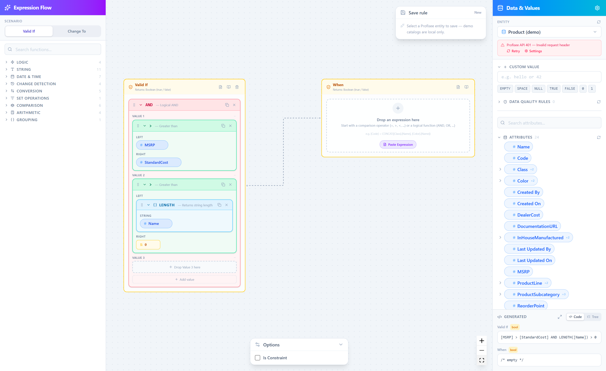
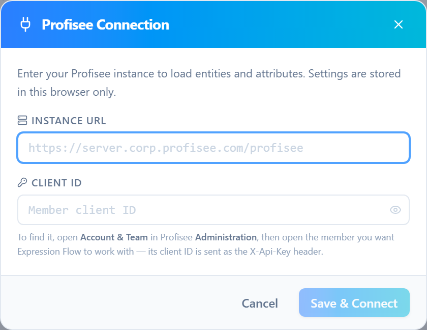
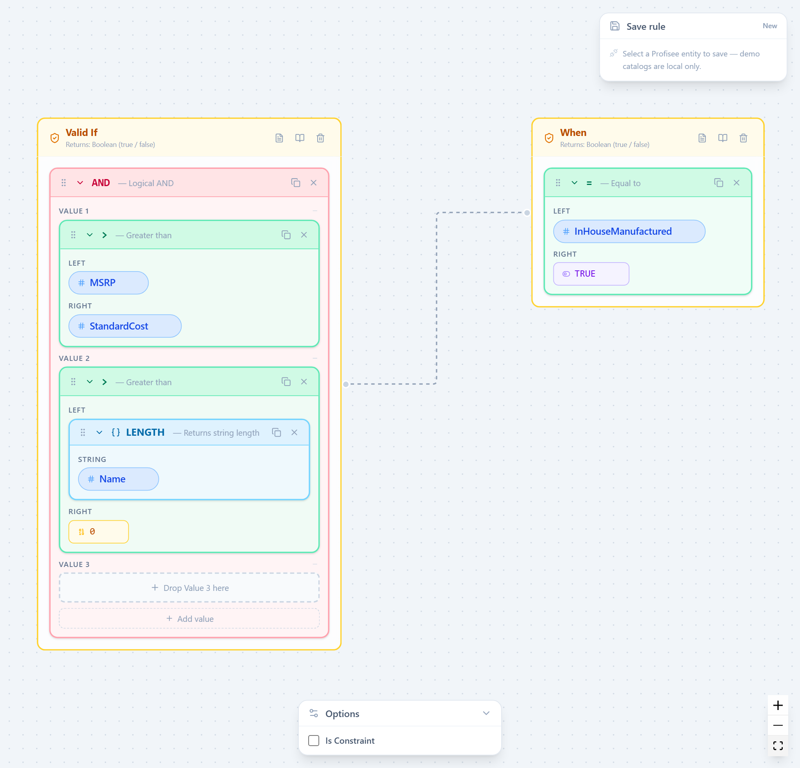
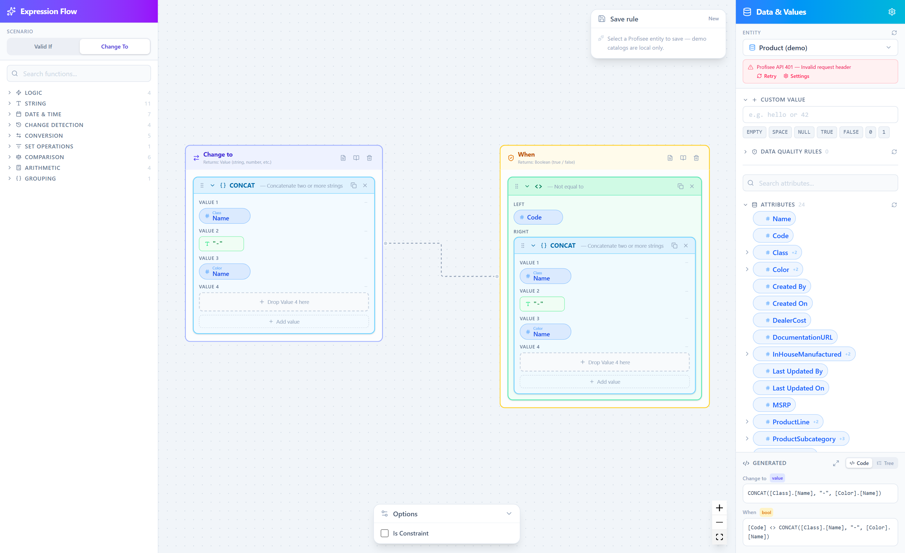
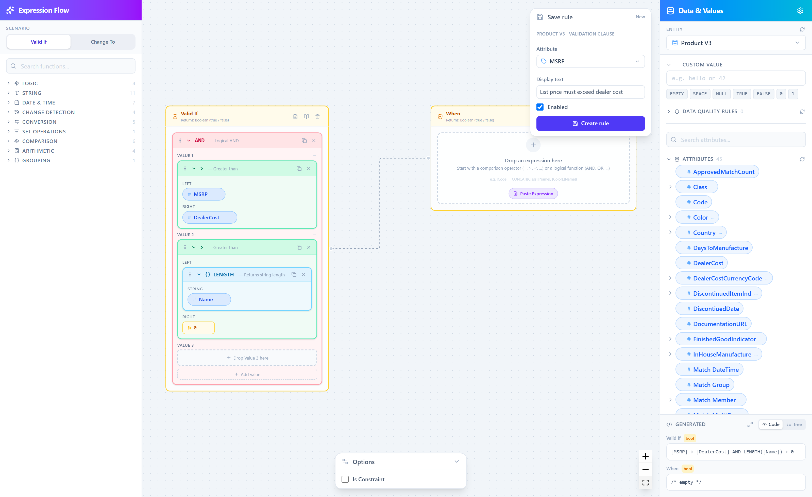

<div align="center">

# Expression Flow

**Build Profisee business rules visually — drag blocks instead of writing expression syntax.**

[Download the Chrome extension](../../releases/latest) · [Live instance](https://corpltr50.corp.profisee.com/expression-flow/) · [Presentation slides](Expression-Flow-Hackathon-Presentation.pdf)

</div>

> [!IMPORTANT]
> **Disclaimer:** Expression Flow is not an official Profisee product. Profisee
> does not support it, and it comes with no warranty. Use it at your own risk.



## Contents

- [Features](#features)
- [Install the Chrome extension](#install-the-chrome-extension)
- [Use the extension](#use-the-extension)
- [Connect to Profisee](#connect-to-profisee)
- [Rule scenarios](#rule-scenarios)
- [Development](#development)
  - [Run the web app](#run-the-web-app)
  - [Build the extension](#build-the-extension)
  - [Tests](#tests)
  - [Real-environment tests](#real-environment-tests)
- [CI and releases](#ci-and-releases)
  - [Publish a release](#publish-a-release)

## Features

- **Blocks, not syntax.** 43 typed blocks in 9 categories: logic, string, date and
  time, change detection, conversion, sets, comparison, arithmetic and grouping.
- **Live expression.** The canvas shows the exact text that Profisee runs.
- **Round trip.** Paste or load an existing rule. It becomes blocks you can edit.
- **Your data model.** Entities, attributes and related attributes (`[Class].[Name]`)
  come from the connected instance.
- **Data Quality Rules.** List the rules of an entity, load a clause into the
  canvas, and save it back.
- **Offline demo.** Built-in demo catalogs work without a connection.

## Install the Chrome extension

You need Chrome 116 or later.

1. Download [`expression-flow-extension.zip`](../../releases/latest/download/expression-flow-extension.zip)
   from the [latest release](../../releases/latest).
2. Unzip it to a folder that you keep, for example `Documents\expression-flow`.
   Chrome loads the extension from this folder each time it starts.
3. Open `chrome://extensions`.
4. Turn on **Developer mode** (top right).
5. Click **Load unpacked** and select the unzipped folder.
6. Pin **Expression Flow** to the toolbar (puzzle icon → pin).

**To update:** download the new zip, replace the contents of the same folder, then
click the reload icon on the extension card in `chrome://extensions`.

## Use the extension

1. Click the toolbar icon. The popup shows your saved instances.
2. Click **New**. Enter a name (optional), the instance URL and the client ID.
3. Click **Test connection**. When Chrome asks for access to the instance host,
   allow it. A passed test saves the instance.
4. Click **Open in tab** to open the editor on that instance. If the editor is
   already open, it comes to the front and reconnects. **In use** marks the
   instance that the editor uses.

To rename an instance, select it and edit **Name**. To delete it, click its trash
icon, then **Delete**. The extension calls the Profisee REST API directly. The
browser must trust the server's TLS certificate.

## Connect to Profisee

The web app asks for the connection on first load. You can also open it with the
gear icon in the **Data & Values** panel. The settings stay in your browser.

<div align="center">
  
</div>

- **Instance URL:** the Profisee service URL, for example
  `https://server.corp.profisee.com/profisee`.
- **Client ID:** in Profisee **Administration**, open **Account & Team**, then open
  the member to use. The app sends this client ID as `X-Api-Key`, so it reads and
  writes with the permissions of that member.

## Rule scenarios

| Valid If | Change To |
| --- | --- |
| A boolean rule that flags records that fail validation. An optional **When** guard limits the records it checks. | A value expression that sets an attribute. The **When** condition selects the records to change. |
|  |  |

To save a rule, select the attribute it attaches to, enter a display text, and
click save. The **Data Quality Rules** section lists the rules of the entity.
Click a clause to load it into the canvas.



## Development

Install [Node.js](https://nodejs.org/) 22 or later, then run `npm install`.

### Run the web app

```bash
npm run dev       # dev server on http://localhost:5173/expression-flow/
npm run build     # type-check and build to dist/
npm run preview   # serve dist/ on http://localhost:4173/expression-flow/
```

The dev server can proxy the Profisee API, so the client ID stays out of the
browser. Put these keys in `.env` (git ignores it):

```ini
PROFISEE_TARGET=https://server.example.com/instance   # instance URL
QA_CLIENT_ID=<client id>                              # sent as X-Api-Key
```

`PROFISEE_API_KEY`, if set in `.env` or in your shell, replaces `QA_CLIENT_ID`.

### Build the extension

```bash
npm run build:extension    # unpacked extension in dist-extension/
npm run package:extension  # also zips it to expression-flow-extension.zip (Windows)
```

To test a local build, load `dist-extension/` with **Load unpacked**.

### Tests

```bash
npm test      # vitest, single run
npm run lint  # eslint
```

### Real-environment tests

`src/__tests__/real-env-rules.test.ts` runs every Data Quality Rule of a live
instance through the REST client, the parser, the code generator and the store.
The rules come from `src/__tests__/fixtures/real-env-rules.json`. That file is
anonymized: attribute names, entity names, string values, display text and ids
are replaced by pseudonyms. The tests also fail if the fixture contains any value
that is not a pseudonym or platform syntax.

To refresh the fixture from the instance in `.env`:

```bash
npm run capture:fixture
```

The capture script only sends GET requests. It keeps the raw data in memory and
writes only the anonymized file. Before it writes, it searches the output for
every original value and stops if it finds one. Review the diff before you commit.

## CI and releases

`.github/workflows/ci.yml` runs on each pull request into `main`, on each push to
`main`, and on each version tag:

1. Lint, test, and build the web app.
2. Build the Chrome extension and attach the zip to the workflow run.
3. On a version tag only: publish a GitHub release with
   `expression-flow-extension.zip`.

The extension version is the `version` in `package.json`.

### Publish a release

1. Write the release description in `.github/release-notes/v<version>.md`
   (copy the last one). For pictures, use
   `https://raw.githubusercontent.com/{{REPO}}/{{TAG}}/docs/images/<file>.png`;
   CI fills in `{{REPO}}` and `{{TAG}}`. CI adds the list of changes below it.
2. On an up-to-date `main`, run:

```bash
npm version patch          # or minor / major: updates package.json, commits, tags v1.0.1
git push --follow-tags     # pushes the commit and the tag
```

The release starts when the tag reaches GitHub. Tags must look like `v1.2.3`, and
CI stops if the tag does not match the `package.json` version.

To correct the description of the current release, edit its notes file and push
to `main`. CI updates the release that matches the `package.json` version.
